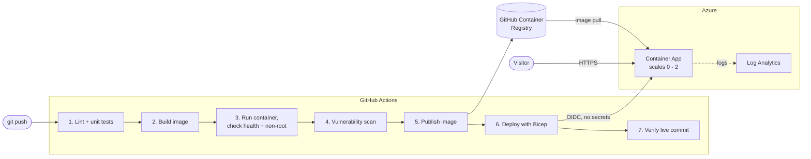

# Container CI/CD pipeline to Azure

[](../../actions/workflows/ci-cd.yml)

Every push to `main` is tested, built into a container image, scanned for
vulnerabilities, published to a registry and deployed to Azure Container Apps -
without anyone touching a server or typing a password.

The web app itself is deliberately tiny. The subject of this repository is the
**delivery pipeline** around it.

## How a change reaches production



Each step is a gate. If the tests fail, nothing is built. If the container does
not start or runs as root, it is not scanned. If the scan finds a critical
vulnerability that has a fix, the image is never published. Only an image that
passed everything can reach Azure.

## What this project demonstrates

| Topic | How it is applied here |
| --- | --- |
| CI/CD | One pipeline from commit to running app, with a gate at every step |
| Containers | Multi-stage Dockerfile, small final image, non-root user, health check |
| Traceability | Image tag = commit hash; the running app reports which commit it is |
| Supply chain security | Image is scanned before it is published, pinned dependencies |
| Infrastructure as Code | Azure resources defined in Bicep, deployed by the pipeline |
| Passwordless deployment | GitHub logs in to Azure with OIDC, no stored client secret |
| Verification | Smoke test after deploy proves the new commit is actually live |
| Cost awareness | The app scales to zero when idle |
| Observability | Container logs flow to Log Analytics |

## Repository layout

```
.
├── app/main.py               # The web service (FastAPI)
├── tests/test_app.py         # Unit tests
├── Dockerfile                # Multi-stage, non-root image
├── infra/main.bicep          # Azure Container Apps + Log Analytics
├── .github/workflows/ci-cd.yml
├── docs/design-decisions.md
├── requirements.txt          # Runtime dependencies (pinned)
└── requirements-dev.txt      # Test and lint tools (pinned)
```

## Run it locally

```bash
# Without Docker
python -m venv .venv && source .venv/bin/activate
pip install -r requirements-dev.txt
pytest
uvicorn app.main:app --reload        # http://localhost:8000

# With Docker
docker build --build-arg GIT_SHA=local -t cicd-demo .
docker run --rm -p 8000:8000 cicd-demo
```

| Endpoint | Purpose |
| --- | --- |
| `/` | Simple page showing the running commit |
| `/healthz` | Health check used by Docker, Azure and the pipeline |
| `/api/info` | Commit, environment and replica that answered |

## Pipeline stages

| Job | Runs on | Needs Azure | What it does |
| --- | --- | --- | --- |
| Lint and test | Every push and pull request | No | `ruff`, `pytest` |
| Build, scan and publish | Every push and pull request | No | Builds the image, starts it, scans it; publishes only from `main` |
| Deploy to Azure | Push to `main` | Yes (OIDC) | Deploys `infra/main.bicep`, then verifies the live commit |

The first two jobs work immediately after forking: the image is published to
this repository's own GitHub Container Registry using the built-in token.

## Enabling the Azure deployment

The deploy job is skipped until these **repository variables** exist
(Settings → Secrets and variables → Actions → Variables):

| Variable | Value |
| --- | --- |
| `AZURE_CLIENT_ID` | Client ID of an app registration with a federated credential for this repo |
| `AZURE_TENANT_ID` | Your Entra ID tenant ID |
| `AZURE_SUBSCRIPTION_ID` | Your subscription ID |
| `AZURE_RESOURCE_GROUP` | Optional. Defaults to `rg-cicddemo-dev` |
| `AZURE_LOCATION` | Optional. Defaults to `westeurope` |

Two one-time steps:

1. Give the app registration the **Contributor** role on the subscription (or
   on the resource group, if you create that yourself first). Microsoft's guide:
   [Connect GitHub to Azure with OpenID Connect](https://learn.microsoft.com/azure/developer/github/connect-from-azure-openid-connect).
2. Make the container image public so Azure can pull it without credentials:
   repository page → **Packages** → the package → **Package settings** →
   **Change visibility** → Public.

To deploy by hand instead:

```bash
az group create --name rg-cicddemo-dev --location westeurope
az deployment group create \
  --resource-group rg-cicddemo-dev \
  --template-file infra/main.bicep \
  --parameters image=ghcr.io/<owner>/<repo>:latest
```

Clean up with `az group delete --name rg-cicddemo-dev`.

## Cost

With `minReplicas` set to 0 the app stops when nobody uses it, and Azure
Container Apps includes a monthly free grant. For a demo with little traffic
the cost is close to zero. Prices change, so check the
[Azure pricing calculator](https://azure.microsoft.com/pricing/calculator/).

## Design decisions

The reasoning behind the main choices, and what would change for production,
is in [docs/design-decisions.md](docs/design-decisions.md).

## Author

Built by [JerProjects8576](https://github.com/JerProjects8576), a final-year
Computer Engineering student looking for a graduation internship in Cloud
Engineering or DevOps.
